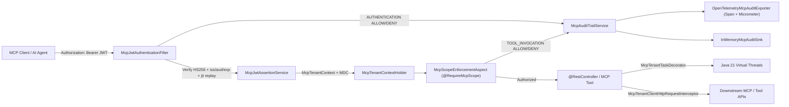

# `spring-boot-starter-mcp-security`

> **A lightweight Spring Boot 3 starter for securing enterprise Model Context Protocol (MCP) servers with OAuth 2.0 JWT assertions, tenant context propagation, and OpenTelemetry audit trails.**

[](https://openjdk.org/projects/jdk/21/)
[](https://spring.io/projects/spring-boot)
[](LICENSE)

---

## Why This Exists

Enterprise Model Context Protocol (MCP) servers sit directly in front of internal databases, Kubernetes clusters, and production APIs. Out of the box, most MCP tool servers lack:

1. **Cryptographic Agent & Capability Identity** — Distinguishing *which tenant*, *which agent*, and *which capability* invoked a tool (`tenant_id`, `capability_id`, `scope`), rather than sharing a static API key.
2. **Thread-Safe Tenant Isolation on Virtual Threads** — Carrying tenant context, SLF4J MDC tags, and outbound HTTP correlation headers safely across Java 21 virtual threads and async executors.
3. **Zero-Friction Compliance Audit Trails** — Attaching structured security decisions (`ALLOW` / `DENY`) directly to active OpenTelemetry spans and Micrometer counters for every authentication check and tool execution.

`spring-boot-starter-mcp-security` solves all three via standard Spring Boot 3 auto-configuration—zero boilerplate, readable in 5 minutes.

---

## Architecture



---

## Installation

### Maven

```xml
<dependency>
    <groupId>com.aegis.mcp</groupId>
    <artifactId>spring-boot-starter-mcp-security</artifactId>
    <version>1.0.0</version>
</dependency>
```

### Gradle (Kotlin DSL)

```kotlin
implementation("com.aegis.mcp:spring-boot-starter-mcp-security:1.0.0")
```

> **Optional Web Layer:** Servlet filtering (`McpJwtAuthenticationFilter` & `mcpSecurityFilterChain`) auto-activates in Spring WebMVC servlet applications. Non-web workers (Kafka consumers, batch jobs) still receive `McpJwtAssertionService`, `McpTenantContextHolder`, `McpScopeEnforcementAspect`, and OpenTelemetry audit trails.

---

## 3-Step Quickstart

### 1. Configure `application.yml`

```yaml
mcp:
  security:
    enabled: true
    issuer: https://auth.enterprise.internal
    audience: mcp://prod-tool-cluster
    hmac-secret: ${MCP_JWT_HMAC_SECRET}
    token-ttl-seconds: 300
    replay-protection-enabled: true
    protected-path-patterns:
      - /mcp/**
      - /v1/mcp/**
```

### 2. Protect MCP Tools with `@RequireMcpScope`

```java
@RestController
@RequestMapping("/mcp/tools")
public class KubernetesMcpController {

    @GetMapping("/pods/logs")
    @RequireMcpScope(value = {"k8s:logs:read"}, toolName = "k8s.pods.logs")
    public Map<String, Object> readPodLogs() {
        McpTenantContext ctx = McpTenantContextHolder.require();
        return Map.of(
                "tenant", ctx.tenantId(),
                "capability", ctx.capabilityId(),
                "traceId", ctx.traceId(),
                "tokenBudget", ctx.tokenBudgetLimit()
        );
    }

    @PostMapping("/pods/restart")
    @RequireMcpScope(
            value = {"k8s:pods:restart", "sre:admin"},
            mode = LogicalMode.ANY,
            toolName = "k8s.pods.restart"
    )
    public Map<String, String> restartPod() {
        return Map.of("status", "restarted");
    }
}
```

### 3. Propagate Context Across Virtual Threads & Downstream HTTP Calls

```java
// Propagates McpTenantContext + SLF4J MDC across Java 21 virtual threads
TaskDecorator decorator = new McpTenantTaskDecorator();
Runnable task = decorator.decorate(() -> {
    McpTenantContext ctx = McpTenantContextHolder.require();
    // Executes with tenant_id, capability_id, and trace_id intact
});

// Propagates X-Tenant-Id, X-Capability-Id, X-Trace-Id, and attenuated Bearer token
RestClient restClient = RestClient.builder()
        .requestInterceptor(new McpTenantClientHttpRequestInterceptor(
                assertionService, true, "mcp://downstream-db-tool", Set.of("db:select"), 60))
        .build();
```

---

## OAuth 2.0 JWT Assertions & Token Attenuation

### RFC 7523 Client Assertions (`jwt-bearer`)

Configure authorized clients under `mcp.security.clients`:

```yaml
mcp:
  security:
    clients:
      aegis-sre-agent:
        client-secret: ${AEGIS_CLIENT_SECRET}
        tenant-id: tenant-acme
        allowed-scopes:
          - k8s:logs:read
          - k8s:pods:restart
```

Mint and verify assertions programmatically:

```java
String assertion = assertionService.createClientAssertion("aegis-sre-agent", clientSecret);
String verifiedClientId = assertionService.verifyClientAssertion(assertion);
```

### RFC 8693 Least-Privilege Token Attenuation

Exchange a broad caller context for a short-lived downstream token with strictly narrowed scopes (attempting scope escalation throws `McpAccessDeniedException`):

```java
McpTenantContext caller = McpTenantContextHolder.require();
String downstreamJwt = assertionService.exchangeForToolScopedToken(
        caller,
        "mcp://billing-ledger-server",
        Set.of("ledger:read"),
        60
);
```

---

## OpenTelemetry Audit Trails & Metrics

Every authentication check (`AUTHENTICATION`) and `@RequireMcpScope` invocation (`TOOL_INVOCATION`) emits a structured `McpAuditEvent` exported via `OpenTelemetryMcpAuditExporter` and recorded in `InMemoryMcpAuditSink`:

### Span Attributes & Event (`mcp.security.audit`)

| Signal | Name | Description |
|---|---|---|
| Span Attribute | `mcp.tenant.id` | Authenticated tenant identifier (`tenant_id` claim) |
| Span Attribute | `mcp.capability.id` | Authorized MCP capability (`capability_id` claim) |
| Span Attribute | `mcp.auth.subject` | Agent or service principal (`sub` claim) |
| Span Attribute | `mcp.tool.name` | Invoked MCP tool name |
| Span Attribute | `mcp.security.outcome` | `ALLOW` or `DENY` |
| Span Attribute | `mcp.token.jti` | JWT ID (`jti` claim) for replay forensics |
| Span Event | `mcp.security.audit` | Structured audit event with scopes, URI, reason, latency |
| Span Status | `StatusCode.ERROR` | Set automatically on `DENY` outcomes |
| Micrometer Counter | `mcp.security.audit.events.total` | Tagged by `event_type`, `outcome`, and `tenant_id` |

---

## Configuration Properties

| Property | Type | Default | Description |
|---|---|---|---|
| `mcp.security.enabled` | `boolean` | `true` | Enables or disables MCP security auto-configuration |
| `mcp.security.issuer` | `String` | `https://auth.aegis-mcp.internal` | Expected OAuth 2.0 `iss` claim |
| `mcp.security.audience` | `String` | `mcp://enterprise-tool-cluster` | Expected OAuth 2.0 `aud` claim |
| `mcp.security.hmac-secret` | `String` | *(dev fallback)* | HMAC-SHA256 secret (override in production) |
| `mcp.security.token-ttl-seconds` | `long` | `300` | Default lifetime in seconds for minted access tokens |
| `mcp.security.clock-skew-seconds` | `long` | `30` | Clock skew tolerance for `exp` and `iat` checks |
| `mcp.security.replay-protection-enabled` | `boolean` | `true` | Enforces single-use `jti` replay protection |
| `mcp.security.require-capability-claim` | `boolean` | `true` | Requires non-blank `capability_id` claim in tokens |
| `mcp.security.default-token-budget` | `int` | `8000` | Default compute token budget when claim is omitted |
| `mcp.security.default-qpm-limit` | `int` | `60` | Default per-minute query limit when claim is omitted |
| `mcp.security.protected-path-patterns` | `List<String>` | `["/mcp/**", "/v1/mcp/**"]` | Ant URL patterns secured by `McpJwtAuthenticationFilter` |
| `mcp.security.clients` | `Map<String, ClientRegistration>` | `{}` | Registered RFC 7523 confidential clients |

---

## Building & Publishing

```bash
# Run unit & Spring Boot integration tests
mvn clean test

# Build library JAR + sources + javadocs for Maven Central / GitHub Packages
mvn package -Prelease -DskipTests
```

## License

Licensed under the [Apache License, Version 2.0](LICENSE).
